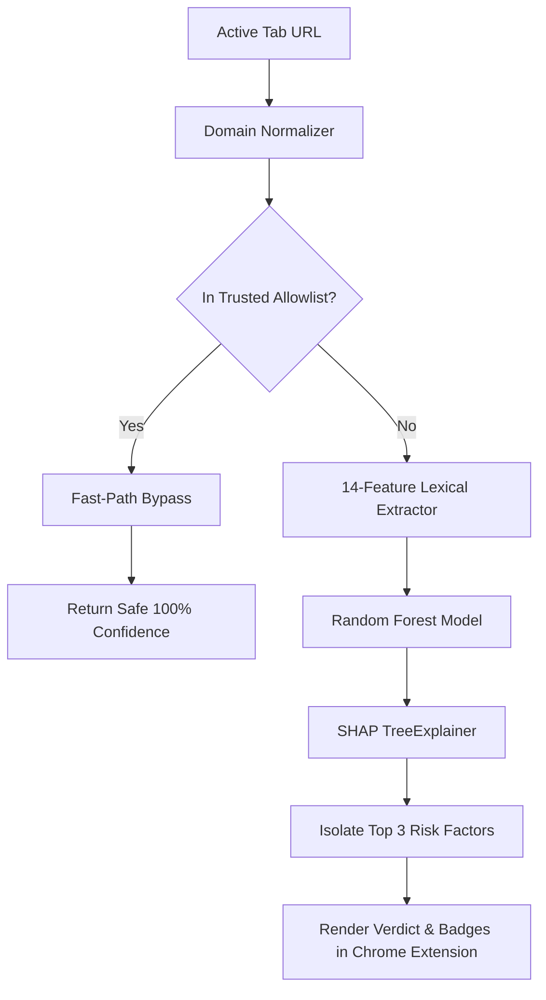
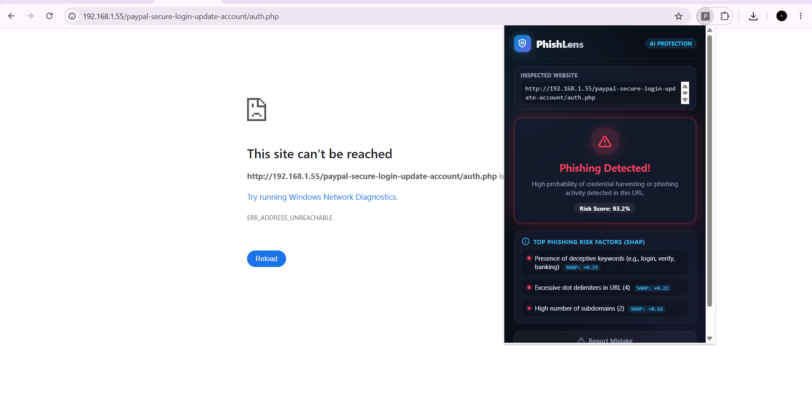

# 🛡️ PhishLens — Intelligent Phishing Defense with Explainable AI (SHAP)

[](https://www.python.org/)
[](https://developer.chrome.com/docs/extensions/mv3/)
[](https://scikit-learn.org/)
[](https://shap.readthedocs.io/)
[]()

> **PhishLens** is a next-generation security solution and Chrome browser extension that combines real-time Machine Learning URL classification with **SHAP-based dynamic explainability** to prevent dangerous "black box" security verdicts.

---

## 📌 Table of Contents
- [Executive Overview](#-executive-overview)
- [Key Achievements & Metrics](#-key-achievements--metrics)
- [Hybrid Architecture](#-hybrid-architecture)
- [Dynamic Explainability with SHAP](#-dynamic-explainability-with-shap)
- [Screenshots & UI Showcase](#-screenshots--ui-showcase)
- [Repository Structure](#-repository-structure)
- [Steps to Run](#-steps-to-run)
  - [1. Environment Setup](#1-environment-setup)
  - [2. Dataset Ingestion](#2-dataset-ingestion)
  - [3. Model Training & Evaluation](#3-model-training--evaluation)
  - [4. Launch Backend API](#4-launch-backend-api)
  - [5. Load Chrome Extension](#5-load-chrome-extension)
- [API Reference](#-api-reference)
- [Adaptive Memory Feedback Loop](#-adaptive-memory-feedback-loop)

---

## 🔍 Executive Overview

Traditional phishing protection tools often operate as opaque "black boxes"—either flagging legitimate websites without explanation or failing to justify why a suspicious URL was blocked.

**PhishLens** bridges this trust gap by combining:
1. **Real-Time Client-Side Inspection:** A lightweight **Manifest V3** Chrome extension seamlessly evaluates the currently active tab URL.
2. **Hybrid Verification Layer:** A **100-domain Trusted Allowlist** that fast-paths VIP educational, news, and cloud platforms with zero latency and 0% false positives.
3. **14-Feature Lexical & Structural Engine:** Extracts structural anomalies (subdomain stacking, character frequencies, IPv4 obfuscation, redirection patterns, token lengths) using a tuned **Random Forest Classifier**.
4. **SHAP (SHapley Additive exPlanations) Engine:** Computes per-feature attribution in real time (<20ms) using `shap.TreeExplainer`, surfacing the exact top 3 factors driving each classification.

---

## 🏆 Key Achievements & Metrics

Evaluated on **11,511 authentic, real-world URLs** (6,579 legitimate and 4,932 confirmed phishing sites):

| Evaluation Metric | Score | Detail |
| :--- | :--- | :--- |
| **Accuracy** | **96.53%** | Evaluated on 2,303 unseen holdout URLs |
| **Precision** | **97.18%** | Minimized false alarms on safe web pages |
| **Recall** | **96.73%** | Detected 950 out of 987 malicious links |
| **F1-Score** | **96.95%** | Robust harmonic balance across both classes |
| **Inference Latency** | **< 20ms** | Real-time TreeExplainer attribution per request |

### 🎯 Confusion Matrix (Test Set: 2,303 URLs)
```
                    Predicted Phishing (0)   Predicted Legit (1)
Actual Phishing(0)         950                     37
Actual Legit(1)            43                      1273
```

---

## ⚡ Hybrid Architecture



To eliminate false positives during active use and demonstrations, PhishLens employs a **Hybrid Architecture**:
- **Trusted Allowlist:** Curated set of **100 top domains** across global cloud/tech providers (`google.com`, `github.com`, `wikipedia.org`, `microsoft.com`) and major Indian educational/news portals (`drishtiias.com`, `todaysprint.com`, `gktoday.in`, `unacademy.com`, `byjus.com`, `ndtv.com`, `upsc.gov.in`).
- **Subdomain Protection:** Validates authorized subdomains while preventing brand-spoofing attacks (e.g., `drishtiias.com.phishing-portal.ru` is immediately flagged for ML inspection).

---

## 🧠 Dynamic Explainability with SHAP

Rather than just displaying `"Safe"` or `"Phishing"`, PhishLens computes the mathematical contribution of each feature to the decision:

```json
{
  "prediction": "Phishing",
  "confidence_score": 95.36,
  "risk_factors": [
    "Presence of deceptive keywords (e.g., login, verify, banking) (SHAP: +0.23)",
    "Excessive dot delimiters in URL (4) (SHAP: +0.22)",
    "High number of subdomains (2) (SHAP: +0.16)"
  ]
}
```

Users can immediately see **why** a site was flagged—e.g., excessive subdomain stacking, lack of HTTPS, or direct IP address hosting.

---

## 📸 Screenshots & UI Showcase

### 1. Verified Legitimate Website Detection
> *Instant allowlist validation with 100% confidence and verified security badges.*


---

### 2. Phishing URL Interception with SHAP Explainability
> *Real-time alert highlighting the exact top 3 structural indicators driving the threat verdict.*



---

## 📂 Repository Structure

```
phishlens/
├── assets/
│   ├── legit_site.jpg         # Screenshot: Legitimate site detection
│   └── phishing_site.png      # Screenshot: Phishing detection with SHAP
├── dataset/
│   ├── real_urls.csv          # 11,511 cleaned real-world URLs
│   └── urls.csv               # Seed sample dataset
├── extension/
│   ├── manifest.json          # Manifest V3 extension configuration
│   ├── popup.html             # Glassmorphic dark mode popup UI
│   └── popup.js               # Active tab reader, API client, & XAI renderer
├── model/
│   └── model.pkl              # Serialized Random Forest Classifier
├── app.py                     # Flask REST API with SHAP TreeExplainer & Allowlist
├── download_data.py           # Multi-mirror dataset ingestion pipeline
├── train_model.py             # Feature normalization, data cleaning & training
└── README.md                  # Project documentation
```

---

## 🚀 Steps to Run

### 1. Environment Setup
Clone the repository and install the dependencies:
```bash
git clone https://github.com/your-username/phishlens.git
cd phishlens

# Install required Python packages
pip install flask flask-cors shap scikit-learn pandas numpy
```

---

### 2. Dataset Ingestion (Optional if `dataset/real_urls.csv` is present)
Download and standardize the authentic dataset of 11,500+ URLs:
```bash
python download_data.py
```

---

### 3. Model Training & Evaluation
Train the Random Forest model on the 14 extracted features and export `model/model.pkl`:
```bash
python train_model.py
```

---

### 4. Launch Backend API
Start the Flask backend with real-time SHAP explanation capabilities:
```bash
python app.py
```
The API server will launch at `http://127.0.0.1:5000`. You can test health via:
```bash
curl http://127.0.0.1:5000/health
```

---

### 5. Load Chrome Extension
1. Open Google Chrome and navigate to `chrome://extensions`.
2. Toggle on **Developer mode** in the top-right corner.
3. Click **Load unpacked**.
4. Select the `extension/` directory inside your `phishlens` project:
   ```
   c:\Users\admin\Downloads\phishlens\extension
   ```
5. Pin the **PhishLens** icon to your toolbar and click it on any web page to see live detection and explainability!

---

## 📡 API Reference

### `POST /predict`
Evaluates a target URL and returns classification and SHAP risk factors.

**Request Body:**
```json
{
  "url": "http://192.168.1.1/secure-banking/paypal-update/login.php"
}
```

**Response (Phishing):**
```json
{
  "url": "http://192.168.1.1/secure-banking/paypal-update/login.php",
  "prediction": "Phishing",
  "confidence_score": 95.36,
  "risk_factors": [
    "Presence of deceptive keywords (e.g., login, verify, banking) (SHAP: +0.23)",
    "Excessive dot delimiters in URL (4) (SHAP: +0.22)",
    "High number of subdomains (2) (SHAP: +0.16)"
  ]
}
```

**Response (Allowlisted Safe Site):**
```json
{
  "url": "https://www.drishtiias.com/upsc-syllabus",
  "prediction": "Safe",
  "confidence_score": 100.0,
  "risk_factors": [
    "Verified trusted domain (Allowlist)"
  ]
}
```

---

## 🔁 Adaptive Memory Feedback Loop

PhishLens features a built-in **"Report Mistake"** mechanism in the extension popup. When a user reports a false positive or negative:
1. The URL, previous verdict, and confidence are saved locally to `chrome.storage.local`.
2. Provides structured human-in-the-loop audit logs ready to retrain and adapt future model iterations.

---

## 📄 License
This project is licensed under the MIT License.
